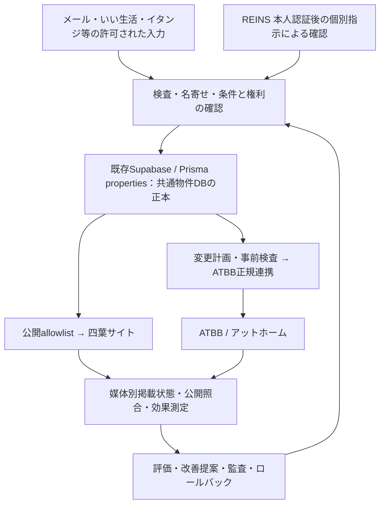

# メール取込と既存DBの境界

2026-10-26。原設計（2026-10-22 v0.2）と本人の再確認を維持する。

## 正本は四葉サイトの既存DB



- `prisma/schema.prisma` の `Property` / `properties` と既存ID・slugを維持する。公開ページは既存 `src/lib/properties.ts` / `toPublicProperty` を通す。
- 入力段階の候補、募集episode、媒体別掲載状態、公開観測、監査は別の責務。メールやATBBの状態で物件本体を無条件に上書きしない。
- 今回のローカル候補ファイルは取込前検査用。正本でも本番用の第二DBでもない。メールからサイト/ATBBへ直接配信する経路は作らない。
- 本番接続では、候補を既存DBの物件・募集回に名寄せし、確認済み根拠と最新の版を使って既存writerに渡す必要がある。メールIDから物件ID・slug・episodeを生成して登録しない。
- AD・当社報酬・業者間情報は内部専用。メール原文・添付を公開データへコピーしない。

## 今回の最小実装

`mail-intake.ts` は既に読み取る権限のあるメールの正規化入力だけを受ける。受信日時はコネクタ由来の `provider_internal_date` で判定し、処理時点から過去168時間（境界を含む）まで。メールのDateヘッダーや引用本文の日付は代用しない。送信済み・下書き・迷惑・ゴミ箱は除外。不明な受信箱/時刻は保留。

受信7日と物件更新14日は別の条件。物件更新日時の抽出候補があっても `sourcePropertyUpdate.basis=unknown`、`normalization=unconfirmed` のまま既存 `rentalFieldEvidenceSchema` に渡す。採否・掲載承諾は確認済みにならない。

対応する数値抽出は、UTF-8へ正しく復号済みのplain text 1 partで、先頭の`物件名:`から連続する単一のラベルブロックだけ。`取引種別`、`用途`、`賃料`（整数円）、`管理費`（整数円）、`間取り`、`専有面積`、`契約形態`、`物件更新日時`（UTCミリ秒ISO）を提案する。万円表記や不明な値を推定で換算しない。同じラベルの反復、複数part、説明文/空行後の別ラベルは複数物件の可能性があるため全抽出を保留する。一般的なメール書式へ無条件に適用するparserではない。

HTML・添付・文字化け・未確認の復号・日報・AD変更通知は参照と保留理由のみ。URL・画像・添付は取得せず、HTMLを実行しない。未公開の表示は掲載承諾とせず、広告禁止の表示は内部限定として記録する。文言検知は補助であり、検知しなかったメールも承諾未確認。

## 保存と再実行

`local-mail-inbox.ts` は既存 `createPrivateJournalStore` の0600・排他lock・一時ファイルからのatomic rename・fsyncを再利用する。メールID＋mailboxRefが同じ場合、同内容なら再実行、内容変更なら保留。別IDの同文メールは関連付けだけ行い、別物件や再募集を自動統合しない。head hashが古い要求は拒否する。

保存対象は参照ID・hash・数値候補・時刻・分類候補・保留理由だけ。本文・件名・住所・建物名・画像・AD原文は保存しない。数値も未確認の社内候補であり公開用ではない。最大250件のローカル検査箱で、長期保管・削除の運用や本番DB候補tableを定めるものではない。hashは改変検知用であり署名や権限証明ではない。

保存後の応答喪失を復旧するため、既に取り込んだ同じメールは新規受付の7日判定より先にhashと保存のdurabilityを再照合する。これは手元の入力と既存履歴の照合だけで、古いメールの追加取得や新規取込を許すものではない。

自己改善ではこの正本と掲載経路を固定条件とし、版ごとの差分・評価ケース・独立レビュー・ロールバック手順を残す。新しい書式への対応や採用条件の改善を理由に、名寄せ・媒体別許諾・公開allowlistを省略しない。

## ローカル実行

既存Node/tsxだけを使う。正規化した入力JSONは0600、候補ファイルの親ディレクトリは0700とし、リポジトリ・public・build出力の外へ置く。

```sh
TSX_TSCONFIG_PATH=scripts/property-sync/tsconfig.json node --import tsx scripts/property-sync/mail-local.ts \
  --input /private/path/messages.json --inbox /private/path/inbox.json --mailbox work-mail
```

入力は `{ "schemaVersion": 1, "messages": [...] }`。1回最大25通・ファイル2MB、各mail envelopeは `mailEnvelopeSchema` を参照。既存コネクタをアプリ用OAuthとして流用しない。新しい認証情報・外部通信・メール送受信・DB接続は持たない。標準出力は件数と固定理由コードだけ。競合・不明な保存結果は保留し、同じ入力の再照合で復旧する。

CLI専用tsconfigで `server-only` マーカーをNext同梱のサーバー用empty moduleへ解決する。アプリ側tsconfigと `server-only` importは維持し、クライアント側への取込禁止を変えない。追加packageの導入は不要。

## 未接続

Gmail本番取得、実メール書式ごとの正規化確認、本番用の確認記録readerと取込route、ATBB writer、実権利確認、自動スケジュールは未接続。名寄せと既存DB writerへの合成接続はunit49〜52で実装・検証したが、本番の取込成功を示すものではない。ATBBの契約上認められた連携方式と版・結果照合契約は別途確定する。現在の候補ファイルを本番掲載の根拠として使わない。

## 確認済み取込と既存保存処理の接続（unit52）

`createReviewedMailImport` は認証済みoperator/propertyと確認記録の参照・hash・要求IDだけを受け取る更新専用service。クライアントの承認フラグや自由なpatchを承認済みとして受け取らない。未設定のstoreは `REVIEWED_MAIL_STORE_UNCONFIGURED` で保留し、旧importへのfallbackを持たない。

既存 `properties` の全22列source hashと更新日時を行lock内で照合し、同じtransactionで最新review・募集回・全体rule/policy・広告/本文/全画像の許諾を再確認する。受信168時間、AD込み当社税込総額20万円、元掲載更新14日、間取り/面積/借家、募集状態、公開内容と画像一覧の一致は既存の検証器を組み合わせて判定する。時刻はI/O後にも読み、期限切れを通さない。個別顧客ruleを全体ruleに使わない。

現段階の対象は確認済み文京区物件で、既存importの正規slugを持つ賃貸行のみ。既存ID・slug・掲載statusを維持する。別slug、対象地域不明、新規登録、掲載status変更はこのserviceでは保留。周辺地域の実ルールや新規登録を推定で補わない。`internal.reviewedMailImport` を持つ行の更新・再公開は再確認が必要で、通常編集/旧importからmarkerを除去できない。内容と確認記録を維持した掲載終了だけは通常のCAS経路から可能。

`ReviewedMailStore.readImmutable` は当初のpatchを変更せず、確認が失効した後も権限のある本人の受付結果照合に使える必要がある。`lockCurrent` はサーバー側の実装責任で、確認者の権限・最新募集回・rule/permission履歴の完全性・実素材hashと内容審査を検証し、根拠行をtransaction終了までlockする。hash一致や `approved` 表示だけでは真正性を証明しない。外部API呼出しをDB lock内に入れない。現時点ではこの本番authority readerを供給していない。

既存writerのreceiptを先に確認するため、保存後の応答喪失は失効後も同じ要求から復旧できる。新規保存時は物件・receipt・公開更新の再開計画を同じtransactionへ保存する。計画保存と実際の通知/公開画面更新の実行は別である。receiptと再開計画には生メール、AD、当社報酬、確認者や素材許諾の原文を入れない。旧要求は追加hashを省略した従来のhash契約を維持する。

隔離Postgres検証は合成1物件・媒体2行・媒体監査3行・receipt5行・未実行の再開計画2行。実Prisma/SQLで重複要求のlock待機、古い版・同一日時の手動変更の拒否、途中失敗の一括rollback、保存応答喪失後の新接続での結果照合を確認する。review authorityと画像審査は明示した合成storeであり、本番の権利や実画像を検証済みとはしない。

本番接続前に、(1)確認記録の保管先・失効更新と権限のあるreader、(2)既存DBのreceipt/effects table・RLS・最小権限と適用計画、(3)認証済み取込route、(4)対象1件の限定試験と停止/復旧手順を確定する。今回、本番schema・権限・通知サービスは変更していない。
